<picture>
  <source media="(prefers-color-scheme: dark)" srcset="assets/banner-dark.svg" />
  <source media="(prefers-color-scheme: light)" srcset="assets/banner-light.svg" />
  
</picture>

  

---

## `> whoami`

I'm **Cristian Habana / elhabana**, a game developer working mainly with **Unity and C#**. I combine gameplay programming with 3D and audiovisual creation.

- **Gameplay & systems** — building game logic and reusable, organized architecture.
- **Multiplayer & game AI** — working on player systems for local, online and AI-controlled play.
- **3D & animation** — modeling, environments, assets and integration into interactive projects.
- **Visual & audiovisual** — asset editing, video montage and project presentation content.
- **Currently building UN-CREDIBLES**, a multiplayer superhero party game.
- **Additional experience: GTA Roleplay / FiveM** — adapting server assets and visual content, with small script adjustments and occasional Lua.

> **Open to** game-dev internships, junior roles and collaborations.

---

## `> cat ./projects/un-credibles`

<picture>
  <source media="(prefers-color-scheme: dark)" srcset="assets/uncredibles-dark.svg" />
  <source media="(prefers-color-scheme: light)" srcset="assets/uncredibles-light.svg" />
  
</picture>

<a href="https://www.therookies.co/projects/100977"><picture><source media="(prefers-color-scheme: dark)" srcset="assets/card-roller-hunter-dark.svg" /><source media="(prefers-color-scheme: light)" srcset="assets/card-roller-hunter-light.svg" /></picture></a>

<a href="https://www.therookies.co/projects/96706"><picture><source media="(prefers-color-scheme: dark)" srcset="assets/card-fps-online-dark.svg" /><source media="(prefers-color-scheme: light)" srcset="assets/card-fps-online-light.svg" /></picture></a>

---

<code>&gt; exit</code> · session closed · elhabana // code · create · iterate

