<picture>
  <source media="(prefers-color-scheme: dark)" srcset="assets/banner-dark.svg" />
  <source media="(prefers-color-scheme: light)" srcset="assets/banner-light.svg" />
  
</picture>

  

---

## `> whoami`

I'm **Cristian Habana / elhabana**, a game developer working mainly with **Unity and C#**. I combine gameplay programming with 3D and audiovisual creation.

- **Gameplay & systems** — building game logic and reusable, organized architecture.
- **Multiplayer & game AI** — working on player systems for local, online and AI-controlled play.
- **3D & animation** — modeling, environments, assets and integration into interactive projects.
- **Visual & audiovisual** — asset editing, video montage and project presentation content.
- **Currently building UN-CREDIBLES**, a multiplayer superhero party game.
- **Additional experience: GTA Roleplay / FiveM** — adapting server assets and visual content, with small script adjustments and occasional Lua.

---

## `> ls ./stack`

<picture><source media="(prefers-color-scheme: light)" srcset="https://skillicons.dev/icons?i=unity,cs,vscode,blender,ps&amp;theme=light&amp;perline=5" /></picture>

Game development · 3D &amp; visual · Audiovisual

---

## `> cat ./projects/un-credibles`

<picture>
  <source media="(prefers-color-scheme: dark)" srcset="assets/uncredibles-dark.svg" />
  <source media="(prefers-color-scheme: light)" srcset="assets/uncredibles-light.svg" />
  
</picture>

> [!NOTE]
> **Status: IN DEVELOPMENT** — nothing is released yet.

A multiplayer **superhero party game for up to four players**: quick minigames, humour and competitive chaos.

**Unity 6000.3 · C# · Netcode for GameObjects**

<!-- Add real gameplay footage and a verified public project URL when available.
     The SVG is a typographic project cover, not an in-game screenshot.
     No system is marked as implemented until its status is confirmed. -->

---

<code>&gt; exit</code> · session closed · elhabana // code · create · iterate

